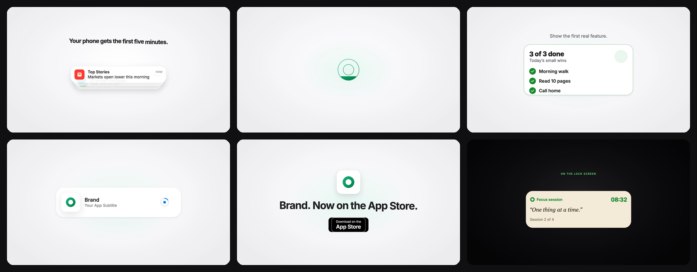
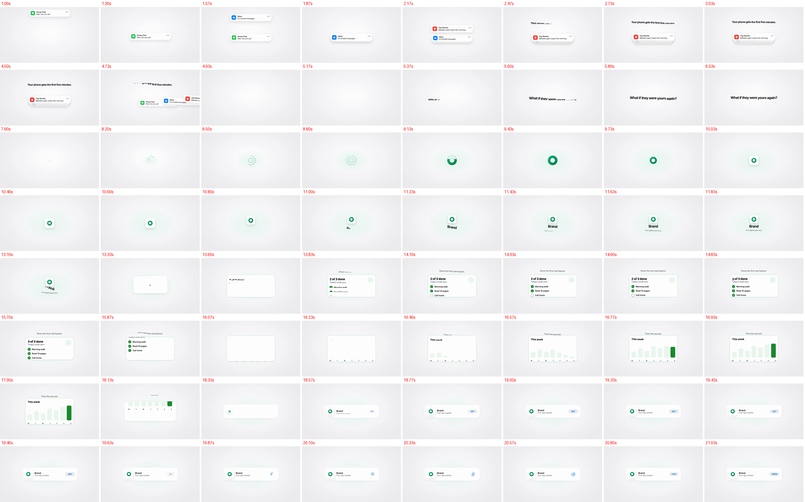
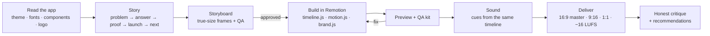

<div align="center">

# App Launch Video

**A Claude skill that turns any app into an Apple-keynote-style launch film using its real UI, spring-physics motion
and spatial sound, with automated QA at every step.**

[](LICENSE)
[](https://docs.claude.com/en/docs/agents-and-tools/agent-skills/overview)
[](https://www.remotion.dev)
[](https://github.com/renthelautomations/app-launch-video/actions/workflows/ci.yml)



</div>

---

## Contents

- [Why](#why)
- [What it does](#what-it-does)
- [See it](#see-it)
- [Install](#install)
- [Use it](#use-it)
- [How it works](#how-it-works)
- [The rules](#the-rules)
- [Quality checks](#quality-checks)
- [Sound](#sound)
- [Formats and delivery](#formats-and-delivery)
- [Repository layout](#repository-layout)
- [Requirements](#requirements)
- [FAQ](#faq)
- [Contributing](#contributing)
- [License](#license)

## Why

Most AI-made product videos look like templates: phone mockups, crossfades, stock whooshes and text that moves
too fast to read. This skill encodes a production process that was refined frame by frame on a real app launch,
with a demanding viewer flagging everything that looked cheap, awkward, unreadable or out of sync. Each rule here
started as a specific complaint, and each has a fix and a check that catches it next time.

## What it does

- **Uses your real product.** It reads your app's theme, fonts and components and rebuilds them at their true
  point sizes. No device mockups.
- **Tells a story.** Problem, then your app as the answer, proof through real features, the launch moment
  (store listing → GET → OPEN → badge), what's coming soon, then an end card.
- **Moves like Apple software.** Spring presets taken from Apple's duration-and-bounce model, shape morphs,
  shared elements, masked type reveals. No crossfades and no blur swaps.
- **Storyboards before it builds.** An HTML storyboard at true 1920×1080, built from your components. It checks
  itself for overlap, clipping, title-safe margins, type size and centering.
- **Checks every render.** Scripts find empty placeholders, single-frame pops, leftover slivers after exits,
  elements that shake, sound out of sync, and harsh or overloaded audio.
- **Sounds designed, not stock.** Plucks tuned to the music's key, foley with body, optional recorded CC0
  samples, binaural 3D placement, music that dips under key moments, and −16 LUFS delivery.
- **Ships every format.** A 16:9 ProRes master plus 16:9, 9:16 and 1:1 MP4s, each with its own layout rules.

## See it

<table>
<tr>
<td width="50%"><br><sub>Logo draws, fills and becomes an icon, which morphs into a real card (from <code>template/</code>).</sub></td>
<td width="50%"><br><sub>The storyboard template: true-size frames plus a QA pass on load.</sub></td>
</tr>
<tr>
<td colspan="2"><br><sub><code>transition_sheets.py</code>: eight frames across each transition, used to catch empty shapes, overlaps and awkward midpoints.</sub></td>
</tr>
</table>

## Install

**Claude Code, personal skill:**

```bash
git clone https://github.com/renthelautomations/app-launch-video.git
cp -R app-launch-video/app-launch-video ~/.claude/skills/
```

**Claude Code, per project:** copy `app-launch-video/` into the project's `.claude/skills/`.

**Claude.ai / Claude apps:** zip the `app-launch-video/` folder and upload it as a skill.

## Use it

Ask in plain language. The skill triggers on launch videos, promos, trailers, teasers and product reveals:

```text
Make a launch video for my app. It just went live on the App Store, and widgets are coming next month.
```

```text
Storyboard a 30-second "coming soon" teaser for our Live Activities, vertical for Reels.
```

```text
Animate our onboarding cards into a short promo. Use the real components from src/components.
```

Claude will look at your app first, then propose a storyboard for you to approve, then build, check and deliver.
Expect a few review rounds. The skill is built around a tight feedback loop.

## How it works



All timing lives in **`template/src/timeline.js`**: spring presets, beat times, every line of type, the music
plan, and the sound cues derived from them. The picture and the soundtrack both read from it, so they can't
drift apart.

## The rules

| | Rule | Why |
|---|---|---|
| 1 | Real components, never device mockups | Mockups read as templates and shrink the product |
| 2 | No crossfades, opacity or blur swaps | Viewers call them cheap; use morphs, masks and carousels instead |
| 3 | The hero stays at the center | Type goes above or below it; the camera only pushes in and out |
| 4 | One meaningful motion at a time | Five simultaneous animations read as mess |
| 5 | Exits must finish | Springs that only *approach* zero leave 1-px slivers at cuts |
| 6 | Hold every line ≥ 2.2 s | If it feels fast, it is |
| 7 | Say what things are | Chapter titles and eyebrow labels for each feature |
| 8 | Minimal and small | The hero takes at most about ⅓ of the frame, with three type sizes |
| 9 | No empty placeholders | Reveal content while the shape is still growing |
| 10 | Sound and picture share one timeline | Sounds land on the first visible frame or the measured impact |
| 11 | Honest and legal | Generic third-party UI, official store badges, licensed assets |
| 12 | Isolate the work | A git worktree or separate folder; the app's build stays untouched |

The details, with the reasoning, are in [`SKILL.md`](app-launch-video/SKILL.md) and
[`references/`](app-launch-video/references).

## Quality checks

| Script | Catches |
|---|---|
| `qa/transition_sheets.py` | Empty shapes, overlaps, cut text, awkward midpoints (contact strips) |
| `qa/pop_scan.py` | Single-frame jumps (only intentional hard cuts should appear) |
| `qa/residue_scan.py` | Slivers and hairlines left after exits |
| `qa/bbox_track.py` | "It shakes": an element that should be still moving or resizing |
| `qa/sync_check.py` | Sounds early or late against the picture, or sounds over a still frame |
| `qa/sfx_report.py` | Each sound's level against the music, brightness, harsh-band share, density |
| storyboard QA | Overlap, clipping, frame bounds, title-safe, type < 20 px, hero off-center |

## Sound

Three families, so the film sounds like one product:

- **Tonal:** plucks tuned to the chord playing at that moment, for UI, type and pops.
- **Paper and foley:** real body between 200 Hz and 4 kHz, never just hiss.
- **Air:** warm, low transition moves.

Headlines get up to five soft plucks, subheads one air rise, labels a single tiny pluck. Exits are silent.
Placement is binaural (MIT KEMAR head recordings) or a stereo pan if that file isn't present. The music dips
3 dB under key moments, and two-pass loudness normalization brings the final mix to −16 LUFS / −1.5 dBTP.
Drop a licensed track at `public/music.mp3` and it replaces the generated score.
See [`references/sound.md`](app-launch-video/references/sound.md) for the level table and free libraries.

## Formats and delivery

| Format | Size | Notes |
|---|---|---|
| 16:9 | 1920×1080 | Master (ProRes 422 HQ) + H.264 |
| 9:16 | 1080×1920 | Text wraps on purpose, wide rows stack, no cropping close-ups, larger off-screen offsets |
| 1:1 | 1080×1080 | Same narrow-format rules |

`scripts/deliver.sh` renders all three, normalizes loudness and muxes the audio. App Store previews must show
features already in the shipping app; see [`references/formats.md`](app-launch-video/references/formats.md).

## Repository layout

```
app-launch-video/                 ← the skill (copy this folder)
├── SKILL.md                     workflow, rules, phases
├── references/                  direction · motion · sound · qa · formats · review
├── assets/storyboard-template.html
├── template/                    working Remotion starter (34 s example film)
│   ├── src/timeline.js          single source of truth for timing
│   ├── src/motion.js            motion primitives and layout
│   ├── src/brand.js             your app: palette, logo, components
│   ├── src/Film.jsx             scenes
│   └── audio.py                 cue-driven soundtrack
└── scripts/                     trace_logo · fetch_hrtf · fetch_kenney · deliver · qa/*
docs/images/                     README media
```

## Requirements

- Node 18+ or Bun, ffmpeg and ffprobe, Chrome (Remotion fetches a headless shell on first render)
- Python 3.10+ with `numpy scipy pillow h5py`
- `potrace` for logo tracing (`brew install potrace` / `apt install potrace`)

Run the template on its own:

```bash
cp -R app-launch-video/template my-film && cd my-film
npm install
bash ../app-launch-video/scripts/fetch_hrtf.sh     # optional: binaural sound
bash ../app-launch-video/scripts/fetch_kenney.sh   # optional: recorded CC0 foley
npx remotion studio src/index.js                  # preview in the browser
node src/export-cues.js && python3 audio.py hrtf/kemar.sofa
bash ../app-launch-video/scripts/deliver.sh mylaunch
```

## FAQ

**Does it work for Android, web or desktop apps?**
Yes. It recreates components from your source (React, SwiftUI, Compose, CSS), and the stage and motion system
don't care which platform they came from.

**Can I use my own music?**
Yes. Put the file at `template/public/music.(mp3|wav|m4a|aif|flac)`. It's loaded before the effects pass, so it
dips under key moments too.

**Can I use this as an App Store preview?**
Only if every feature shown is already in the shipping app and the footage is captured from the app. Cut the
"coming soon" chapters for that version.

**Why HTML strings inside Remotion instead of React components for the UI?**
Components are built at 1× point size and zoomed as one unit, so their layout matches the app exactly and they
can be measured once. Element animations are inline styles computed per frame.

## Contributing

Issues and pull requests are welcome. See [CONTRIBUTING.md](CONTRIBUTING.md). Lessons from your own productions
(a new anti-pattern, a QA check, a format rule) are especially valuable.

## License

[MIT](LICENSE). Downloaded assets keep their own licenses: Kenney sounds are CC0, check sofacoustics.org's terms for
the MIT KEMAR HRTF, Inter is SIL OFL, and store badges belong to Apple and Google (follow their marketing guidelines).
