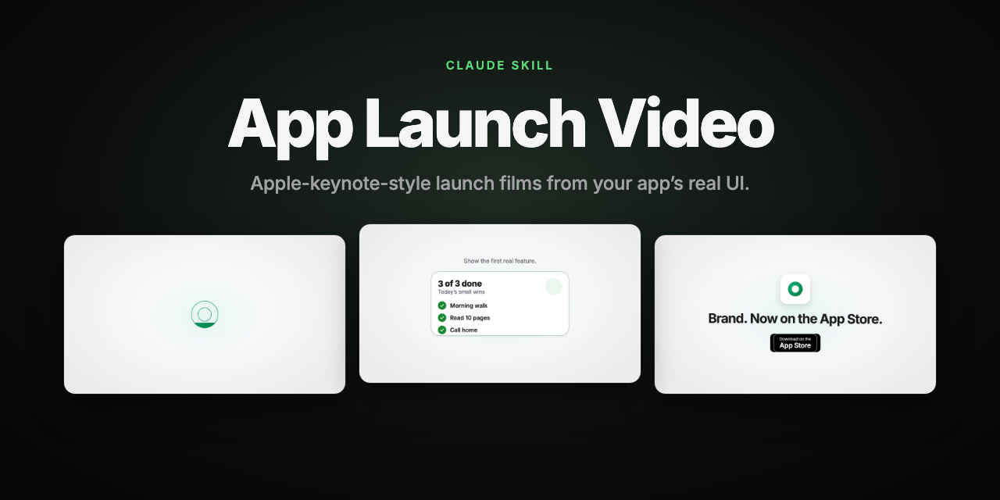
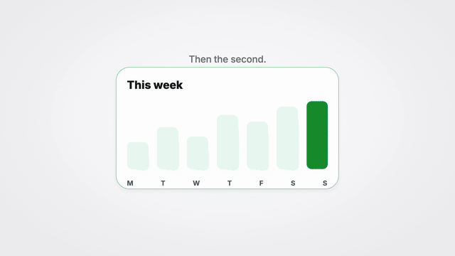
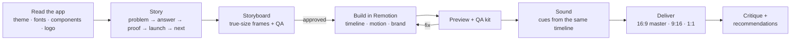
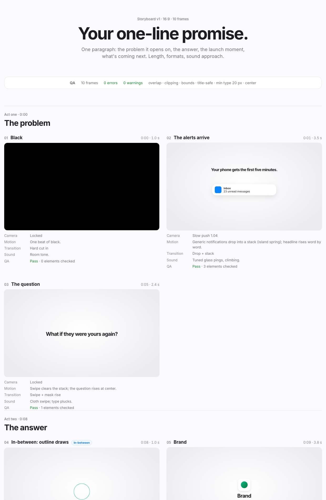

<div align="center">



<p>
  <a href="LICENSE"></a>
  <a href="https://docs.claude.com/en/docs/agents-and-tools/agent-skills/overview"></a>
  <a href="https://www.remotion.dev"></a>
  <a href="https://github.com/renthelautomations/app-launch-video/actions/workflows/ci.yml"></a>
  <a href="CONTRIBUTING.md"></a>
</p>

**Turn any app into a launch film that looks like Apple made it.**<br>
Real UI components, spring-physics motion, spatial sound, automated QA, and 16:9, 9:16 and 1:1 in one run.

[**Watch the example**](docs/example.mp4) · [Install](#install) · [How it works](#how-it-works) · [The rules](#the-rules) · [QA kit](#the-qa-kit)

</div>

---

<table>
<tr>
<td width="50%"></td>
<td width="50%"></td>
</tr>
<tr>
<td><sub><b>The brand moment:</b> the logo outline draws itself, fills, becomes the icon, and morphs into a real feature card.</sub></td>
<td><sub><b>The launch moment:</b> GET → download ring → OPEN, then the button grows into the store badge.</sub></td>
</tr>
</table>

<sub>Both clips come from the 34-second example film in <code>template/</code>. Swap in your own brand and components and it becomes yours. <a href="docs/example.mp4">Full example with sound (MP4)</a></sub>

## Why this exists

Ask an AI for a product video and you usually get phone mockups, crossfades, stock whooshes and captions that move
too fast to read. **This skill is the opposite: a production process refined frame by frame** on a real app launch,
with a demanding reviewer flagging everything that looked cheap, awkward, unreadable or out of sync.

Every rule in it started as one of those complaints. Each one has a measured cause, a fix, and usually a script
that catches it the next time.

| What a viewer said | What was actually wrong | What the skill does now |
|---|---|---|
| "Looks like a template" | Phone mockups | Rebuilds the app's real components on a clean stage |
| "Cheap zoom-blur transitions" | Content swapped by blur and fade | Shape morphs, carousels and masked reveals; opacity never changes |
| "Feels linear, not smooth" | One easing curve for everything | Apple's spring presets assigned by role, plus staggering |
| "Too fast, I can't read it" | 1.5 s per line | At least 2.2 s per line; a longer film rather than a rushed one |
| "It shakes" | Camera move, resizing and rolls all at once | Fixed frames, one motion per change, verified to 0 px drift |
| "There's a dot at the end" | Exit springs never reach 100% | Exits that finish in a fixed time, plus a leftover-pixel scan |
| "The audio feels like a horror movie" | Low detuned drones | A warm major-key score and plucks tuned to it |
| "The sound effects are out of sync" | Cues timed to the spring settling | Cues on the first visible frame, from the same timeline |

<details>
<summary><b>See the full lessons log</b></summary>
<br>

The complete log, with every symptom, cause and fix, is in
[`references/review.md`](app-launch-video/references/review.md). Highlights not in the table:

- Grey and taupe mid-colors during dark↔light changes → hard-edged wipes instead of color interpolation.
- Empty cards for 0.2 s between components → content enters while the shape is still morphing.
- Logo reveals that looked broken (a dot that turns into a blob, carving, pieces assembling) → the outline
  draws itself, then the fill rises.
- Vertical cuts with items parked "off-screen" in view, cropped close-ups, and a headline colliding with the badge →
  format-aware offsets and layouts.
- 230 sound cues (14 per second) → 112, with headlines getting tuned plucks and exits staying silent.

</details>

## What you get

| | |
|---|---|
| **A storyboard first** | An HTML shot list at true 1920×1080 using your components, with in-between frames for every morph and a QA pass that runs on load. You approve it before anything is rendered. |
| **A Remotion project** | One timing file (`timeline.js`) drives picture and sound. Motion primitives, a brand layer for your components, and an example film. |
| **A designed soundtrack** | Score, tuned UI plucks, foley with body, optional CC0 recordings, binaural placement, music that dips under key moments. |
| **Every format** | A 16:9 ProRes master plus 16:9, 9:16 and 1:1 MP4s at −16 LUFS / −1.5 dBTP. |
| **Honest critique** | After every render, a prioritized list of what's still weak, backed by measurements. |

## Install

```bash
git clone https://github.com/renthelautomations/app-launch-video.git
cp -R app-launch-video/app-launch-video ~/.claude/skills/
```

| Where | How |
|---|---|
| Claude Code, everywhere | Copy `app-launch-video/` into `~/.claude/skills/` (above) |
| Claude Code, one project | Copy it into the project's `.claude/skills/` |
| Claude.ai / desktop apps | Zip the `app-launch-video/` folder and upload it in **Settings → Capabilities → Skills** |

## Use it

Talk to Claude normally. The skill picks up launch videos, promos, trailers, teasers and product reveals:

```text
Make a launch video for my app. It just went live on the App Store, and widgets are coming next month.
```

```text
Storyboard a 30-second "coming soon" teaser for our Live Activities, vertical for Reels.
```

```text
Turn our onboarding cards into a short promo. Use the real components in src/components.
```

**What happens next:** Claude reads your theme, fonts and components → proposes a story → builds a storyboard for
your approval → renders a preview and runs the QA kit → designs the sound → delivers every format → tells you
honestly what could still be better. Expect a few review rounds; the process is built for them.

## How it works



<details>
<summary><b>The story structure</b></summary>
<br>

| Act | Stage | What's on screen |
|---|---|---|
| Problem | light | Generic notifications stack up; one line of copy; one swipe clears them |
| Answer | light + glow | A question → the logo draws itself → an icon forms → the name and tagline |
| Proof | light | 2–4 real components, each morphing into the next |
| Launch | light | Store listing → GET → ring → OPEN → headline and official badge |
| Problem two | dark (hard cut) | One line |
| Coming soon | dark | A chapter title card for each feature, then the feature with labels |
| End | dark | Icon, name, badge, one line |

</details>

<details>
<summary><b>The motion system</b></summary>
<br>

Springs use Apple's duration-and-bounce model (from the WWDC23 talk *Animate with springs*):
`stiffness = (2π/d)²`, `damping = (1 − bounce)·4π/d`.

| Preset | Duration, bounce | Used for |
|---|---|---|
| `smooth` | 0.5, 0 | shapes, frames, carousels |
| `text` | 0.7, 0 | type reveals |
| `snappy` | 0.42, 0.12 | decisive morphs |
| `bouncy` | 0.5, 0.3 | meaningful pops only |
| `island` | 0.55, 0.24 | system-surface resizes |
| `exit` | 0.32, 0 | leaving (always completes) |
| `camera` | 2.6, 0 | slow push-ins |

Patterns, anti-patterns and timings are in [`references/motion.md`](app-launch-video/references/motion.md).

</details>

## The rules

1. **Real components, never device mockups.** Mockups read as templates and shrink the product.
2. **No crossfades, opacity or blur swaps.** Use morphs, masked reveals, carousels, wipes or hard cuts.
3. **The hero stays at the center.** Type goes above or below it. The camera only pushes in and out.
4. **One meaningful motion at a time.** Several things animating at once reads as mess.
5. **Exits must finish.** Anything that only *approaches* zero leaves slivers at the cut.
6. **Hold every line ≥ 2.2 s.** If it feels fast, it is.
7. **Say what things are.** Chapter titles and labels like `ON THE LOCK SCREEN`.
8. **Minimal and small.** The hero takes at most about a third of the frame, with three type sizes.
9. **No empty placeholders.** Reveal content while the shape is still growing.
10. **Picture and sound share one timeline.** Sounds land on the first visible frame or the measured impact.
11. **Honest and legal.** Generic third-party UI, official store badges, licensed assets.
12. **Isolate the work.** A git worktree or separate folder; your app's build is never touched.

The reasoning behind each is in [`SKILL.md`](app-launch-video/SKILL.md).

## The QA kit


| Script | Catches |
|---|---|
| `transition_sheets.py` | Empty shapes, overlaps, cut text, awkward midpoints (sheet above) |
| `pop_scan.py` | Single-frame jumps; only intentional hard cuts should appear |
| `residue_scan.py` | Slivers and hairlines left after exits |
| `bbox_track.py` | Elements that should be still but move or resize |
| `sync_check.py` | Sounds early or late against the picture, or sounds over a still frame |
| `sfx_report.py` | Each sound's level against the music, brightness, harsh-band share, density |
| storyboard QA | Overlap, clipping, frame bounds, title-safe, type < 20 px, hero off-center |

<details>
<summary><b>The storyboard</b></summary>
<br>

</details>

## Sound

| Family | Character | Used for |
|---|---|---|
| **Tonal** | Soft kalimba/wood plucks tuned to the chord playing at that moment | UI, type, pops, confirmations |
| **Paper and foley** | Real body (200 Hz–4 kHz), never just hiss | paper, pencil, stamps, letters, cards |
| **Air** | Warm, low pink-noise moves | transitions |

<details>
<summary><b>Levels, spatial audio and music</b></summary>
<br>

| Group | Level vs. music | Examples |
|---|---|---|
| Bed | −19 to −13 dB | text air, word plucks, small taps |
| UI | −15 to −9 dB | plucks, swishes, pushes, alerts |
| Moments | −8 to −1 dB | logo pencil, stamp, brand chord |

- **Spatial:** binaural HRTF convolution (the MIT KEMAR head recordings) following each object's on-screen
  position; falls back to stereo panning without the file.
- **Mix:** the music dips about 3 dB under key moments; the effects' harsh 2.5–5 kHz band and extreme top are
  turned down.
- **Music:** the generated score is a warm major-key piano and pad at 120 BPM. A licensed track at
  `public/music.mp3` replaces it automatically.
- **Loudness:** two-pass `loudnorm` to −16 LUFS integrated and −1.5 dBTP.

</details>

## Formats

| Format | Size | Layout rules |
|---|---|---|
| 16:9 | 1920×1080 | The master; ProRes 422 HQ plus H.264 |
| 9:16 | 1080×1920 | Line breaks placed on purpose, wide rows stack, no cropping close-ups, larger off-screen offsets |
| 1:1 | 1080×1080 | Same narrow-format rules |

> [!IMPORTANT]
> App Store preview videos must show features that are already in the shipping app, captured from the app.
> For a store preview, cut the "coming soon" chapters and use the official store badge artwork.

## Run the template yourself

```bash
cp -R app-launch-video/template my-film && cd my-film
npm install                                          # or: bun install
bash ../app-launch-video/scripts/fetch_hrtf.sh       # optional: binaural sound
bash ../app-launch-video/scripts/fetch_kenney.sh     # optional: recorded CC0 foley
npx remotion studio src/index.js                     # live preview in the browser
node src/export-cues.js && python3 audio.py hrtf/kemar.sofa
bash ../app-launch-video/scripts/deliver.sh mylaunch # all formats, normalized audio
```

**Requirements:** Node 18+ or Bun · ffmpeg/ffprobe · Chrome (Remotion fetches a headless shell) ·
Python 3.10+ with `numpy scipy pillow h5py` · `potrace` for logo tracing.

<details>
<summary><b>Repository layout</b></summary>

```
app-launch-video/                 ← the skill (copy this folder)
├── SKILL.md                      workflow, rules, phases
├── references/                   direction · motion · sound · qa · formats · review
├── assets/storyboard-template.html
├── template/                     working Remotion starter (34 s example film)
│   ├── src/timeline.js           single source of truth for timing, text, cues, music plan
│   ├── src/motion.js             track · words · chars · rise · pop · roll · timer · ex · Shell · Content · Line
│   ├── src/brand.js              your app: palette, logo geometry, components
│   ├── src/Film.jsx              scenes
│   └── audio.py                  cue-driven soundtrack
└── scripts/                      trace_logo · fetch_hrtf · fetch_kenney · deliver · qa/*
docs/                             README media and the example film
```

</details>

## FAQ

<details>
<summary><b>Does it work for Android, web or desktop apps?</b></summary>
Yes. It recreates components from your source (React, SwiftUI, Compose, CSS); the stage and motion system don't
care where they came from.
</details>

<details>
<summary><b>Do I need to know Remotion?</b></summary>
No. Claude builds and edits the project. Knowing it helps if you want to tweak scenes by hand in <code>Film.jsx</code>.
</details>

<details>
<summary><b>Can I use my own music?</b></summary>
Yes. Put it at <code>template/public/music.(mp3|wav|m4a|aif|flac)</code>. It's loaded before the effects pass, so it
still dips under key moments.
</details>

<details>
<summary><b>How long does a film take?</b></summary>
A half-resolution preview renders in about 30–60 s on a recent Mac; a full 70-second master in a few minutes. Most of
the time goes into review rounds, which is where the quality comes from.
</details>

<details>
<summary><b>Why are components HTML strings rather than React components?</b></summary>
They're built at 1× point size and zoomed as one unit, so the layout matches the app exactly and can be measured
once. Per-element motion is inline styles computed each frame.
</details>

## Contributing

Issues and PRs are welcome. The most valuable contribution is a **lesson from a real production**: what a viewer
noticed, what caused it and what fixed it. See [CONTRIBUTING.md](CONTRIBUTING.md).

## Credits

- [Remotion](https://www.remotion.dev): video in React
- [Kenney](https://kenney.nl): CC0 sound effects
- MIT Media Lab KEMAR HRTF via [sofacoustics.org](https://sofacoustics.org)
- [Inter](https://rsms.me/inter/) by Rasmus Andersson (SIL OFL)
- Spring model from Apple's WWDC23 session *Animate with springs*

## License

[MIT](LICENSE) © Renthel Cueto. Downloaded assets keep their own licenses: Kenney sounds are CC0, check
sofacoustics.org's terms for the HRTF data, Inter is SIL OFL, and store badges belong to Apple and Google
(follow their marketing guidelines).
